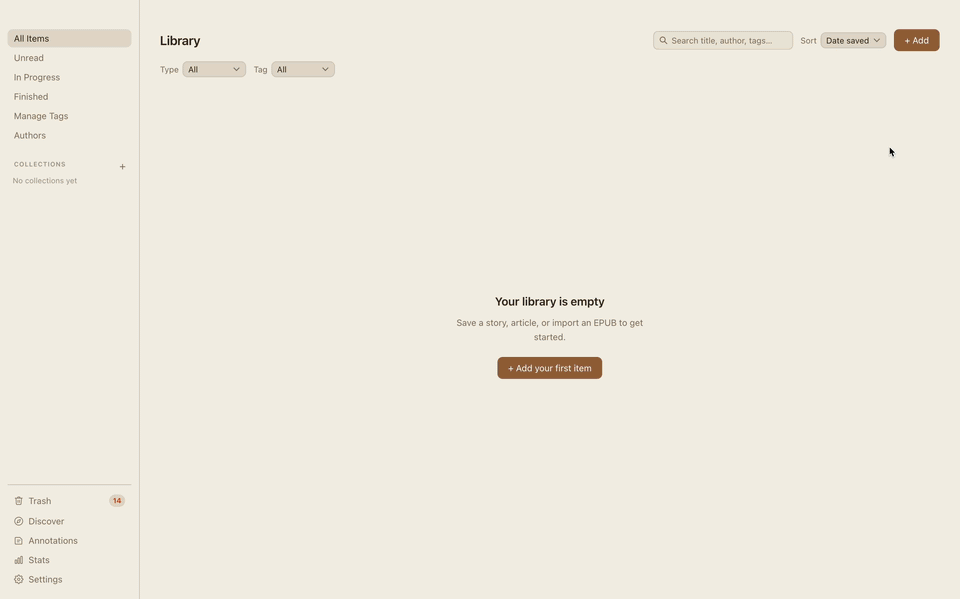
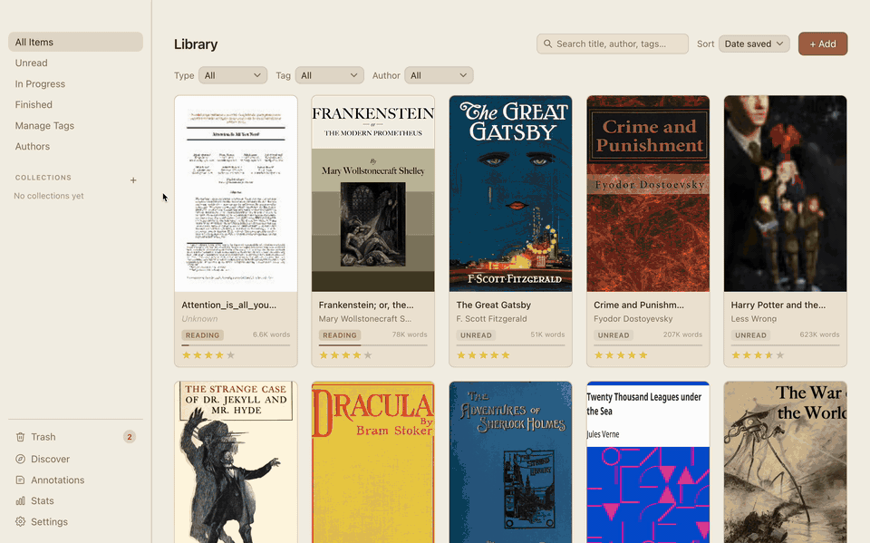
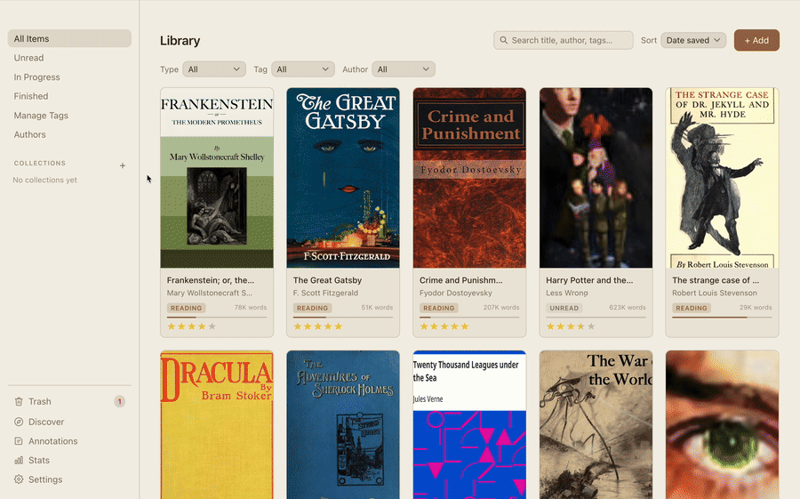
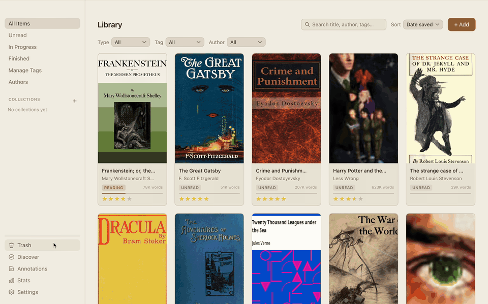
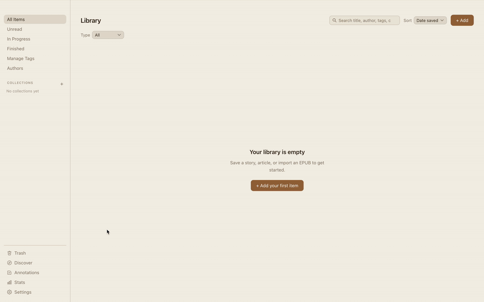

# Personal Library

A desktop app for saving and reading things from the web: articles, fanfiction, web serials, EPUBs, and PDFs. Your library is stored on your own computer and works offline. No account is needed. If you want, you can sign in to back it up and sync it between computers.

  

**[Download the latest release](https://github.com/Williamdiao48/Personal-Library/releases/latest)** for macOS, Windows, or Linux. See [Installing](docs/install.md) for first-launch steps.

## What it does

### Save from the web

Paste a link and the app downloads the page, strips out the clutter, and keeps a clean copy. Multi-chapter stories are downloaded all at once, with a progress bar. There are dedicated parsers for Archive of Our Own, FanFiction.net, Royal Road, Wattpad, Scribble Hub, Spacebattles, and Sufficient Velocity, and a general-purpose one for everything else. You can also import a whole AO3 bookmarks list or FanFiction.net favorites list in one go.

### Read

  

Web pages, EPUBs, and PDFs each open in their own reader. You can change the font, size, line spacing, page width, and color theme, and choose scrolling or page-by-page. There are 15 built-in themes, and you can make your own from two colors. Select any word to look it up in the built-in dictionary, which works offline. PDFs zoom smoothly from 50% to 300%, and Cmd+F searches inside any book.

### Highlight and take notes

  

Highlight passages in four colors, attach notes, and add bookmarks in all three readers. Right-click a highlight to copy, edit, or delete it. The Annotations page collects every highlight from every book in one place, where you can filter them, group them into themes, and export them as Markdown or plain text.

### Organize and search

  

Sort your library with tags, collections, and reading status (Unread, Reading, Finished, On Hold, Dropped). Tags can be renamed and recolored, collections can be reordered by dragging, and you can change many items at once or browse by author. Search covers the full text of everything you've saved, not just titles, and matches partial words as you type. Deleted items go to the Trash and can be restored for 30 days.

### Get recommendations

  

The Discover page suggests fanfiction and books based on what's already in your library. The matching happens on your computer, so your reading history isn't sent anywhere. Recommendations come from AO3, FanFiction.net, and Open Library.

### Track your reading

A stats page shows a year-long activity calendar, reading streaks, time spent per book, and reading speed. You can set goals for time read, books finished, or a reading list.

### Sync between computers (optional)

  

Create a free account to keep your library in sync across computers. Tags, collections, progress, and highlights sync within a few seconds. Book files are only uploaded for the items you choose, or all at once with "Back up all books". Settings → Account handles everything else: signing up with an emailed confirmation code, resetting a forgotten password, and deleting your account along with all of its cloud data. The sync engine is described in [ARCHITECTURE.md](ARCHITECTURE.md). Without an account, nothing leaves your computer.

You can also export your whole library to a single `.plbackup` file and import it on another machine.

## Documentation

- [Installing, updating, and your data](docs/install.md)
- [Building from source and project layout](docs/development.md)
- [Architecture](ARCHITECTURE.md): how the app and its sync layer are designed, and why
- [Testing](docs/testing.md)
